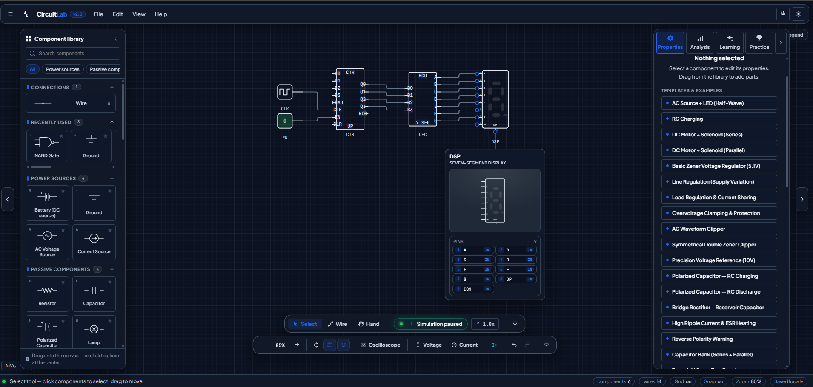

# ⚡ Smart Circuit Simulator

<p align="center">
  <strong>Build circuits. Simulate the physics. See every signal.</strong>
</p>

<p align="center">
  
</p>

<p align="center">


</p>

> **Live demo:** [haedarfarhani.github.io/smart-circuit-simulator](https://haedarfarhani.github.io/smart-circuit-simulator/) — no install, no account, no backend.

---

## What is it?

A **browser-based electrical and digital-logic circuit simulator** with real solvers — not canned animations.
You draw a circuit on an infinite canvas, press Run, and a numeric engine (Modified Nodal Analysis +
transient integration) solves the physics every 100 µs. Every animation, readout and waveform you see is
computed from that same solution.

**Who is it for?**

- 🎓 **Students & teachers** — learn/teach Ohm's law, KCL/KVL, RC/RL transients, semiconductors and digital logic with instant visual feedback
- 🔧 **Makers & hobbyists** — prototype a circuit before touching a breadboard, check currents, power and waveforms safely
- 🧑‍💻 **Curious developers** — a compact, readable, fully-tested TypeScript codebase that implements a real SPICE-style solver from scratch

## Highlights

**Editor**
- 48 components (16 analog + 32 digital) with drag & drop, wiring, rotate/mirror, copy/paste, undo/redo
- Infinite canvas: grid, snap, zoom (10–400 %), pan; touch-first on tablets (pinch-zoom, drawers)
- Autosave to `localStorage`, JSON export/import with schema validation
- Dark / light / system themes, **English & Persian (full RTL)**, keyboard shortcuts everywhere

**Analog simulation**
- Hand-written MNA solver (dense matrix, partial pivoting) — no math libraries
- Time-domain engine: fixed timestep (default 100 µs, adjustable 1 µs–1 ms), Backward Euler for L/C
- Nonlinear devices (diode, Zener, BJT) solved by Newton iteration with junction limiting
- Real device detail: Ebers-Moll BJT with Early effect & thermal model, Zener breakdown with temperature coefficient, polarized-capacitor ESR/ESL/leakage/ripple ratings
- Current-flow animation driven by actual branch currents — direction, speed and junction splits are all measured values

**Digital simulation**
- Event-driven logic kernel co-simulated inside each analog timestep (mixed-signal, not a separate world)
- 4-value logic (`0 / 1 / X / Z`), 8 logic families (CMOS, CD4000, 74HC/HCT/AC, TTL, 74LS, 74ALS) with datasheet-typical thresholds, drive resistance, propagation delay and fan-out
- Gates, MUX/DEMUX, decoders, adders, ALU, latches, flip-flops, registers, counters, seven-segment displays with per-segment brightness from real currents
- Contention, floating-input, setup/hold and fan-out violations produce real warnings — logic outputs drive resistors and LEDs through the same electrical solve

**Instruments**
- 4-channel oscilloscope: voltage/current probes, time & volts/div, auto-scale, trigger (auto/normal/single), live RMS / Vpp / frequency
- I-V curve analyzers (BJT characteristic families, Zener breakdown) sweeping the real models, with CSV export
- Live measurements panel, solver console, human-readable validation errors for invalid circuits

**45 bundled examples** — bridge rectifier, Zener regulator, BJT amplifier, Darlington pair, capacitor ESR heating, 4-bit ALU, shift register, counter → seven-segment display, and more. Every example is editable.

## Components

| Category | Parts |
|---|---|
| **Power & passive** | Battery, AC source, current source, ground, resistor, capacitor, **polarized capacitor** (ESR/ESL/leakage/thermal), lamp, solenoid, switch |
| **Semiconductors** | Diode, **Zener diode** (3 models + presets), LED, **BJT** (NPN/PNP, Ebers-Moll or simplified model) |
| **Actuators** | DC motor, AC motor |
| **Digital logic** | 8 gates (2–4 inputs), MUX/DEMUX, decoder, encoder, adder/subtractor, comparator, ALU, SR/D latches, SR/D/JK/T flip-flops, register, shift register, counter, seven-segment display, BCD decoder, logic I/O, clock generator |

## Technology

| Layer | Choice |
|---|---|
| Language | **TypeScript 5** (strict mode, `tsc --noEmit` in CI) |
| UI | **React 18** + SVG rendering (no canvas/graphics libraries) |
| State | **Zustand 4** — circuit+history, simulation, probes, UI stores |
| Build | **Vite 5** |
| Tests | **Vitest** — **335 unit tests** covering solvers, devices and every bundled example |
| Platform | Any modern browser. Static build → **GitHub Pages** (GitHub Actions). No server, no database. |

## Quick start

```bash
git clone https://github.com/haedarfarhani/smart-circuit-simulator.git
cd smart-circuit-simulator
npm install
npm run dev        # → http://localhost:3000
```

| Command | What it does |
|---|---|
| `npm run dev` | Dev server with hot reload |
| `npm run build` | Typecheck + production build to `dist/` |
| `npm test` | Run all 335 unit tests |
| `npm run typecheck` | TypeScript check only |

## Architecture

Physics is fully separated from rendering. One immutable snapshot per frame drives every view:

```text
Circuit document (plain data)
        ↓  buildTopology (geometry → nodes/branches)
   Analog solver (MNA + Newton)          Digital kernel (event-driven)
   transient step (Backward Euler)  ←──  logic evaluation, delays, Norton stamps
        ↓
  SimulationSnapshot  (t, node voltages, branch currents, device state)
        ↓
  ┌─────────────┬──────────────┬──────────────┬─────────────┐
  │ Current flow│ Oscilloscope │ Measurements │  Analyzers  │
  └─────────────┴──────────────┴──────────────┴─────────────┘
```

```text
src/
  core/            # solvers (MNA, AC, digital kernel), device models, examples, validation
    digital/       # logic values, families, devices, event kernel, Norton stamping
  components/      # canvas layers, panels (scope/measurements), inspector, library, dialogs
  models/          # circuit document & probe types
  store/           # zustand stores (circuit+history, simulation, probes, ui)
  hooks/ utils/    # keyboard shortcuts, clipboard
```

Design rules: components are plain data (the solver dispatches on `type`), renderers never drive the
engine, and every visible control does something real — no placeholder buttons, no fake currents.

## Deployment

Pushing to `main` runs `.github/workflows/deploy.yml`: **typecheck → tests → build → GitHub Pages**.
The Vite base path is set for project sites, so the live demo works under `/smart-circuit-simulator/`.

## Project status & roadmap

- [x] Editor: canvas, library, wiring, persistence, i18n (EN/FA RTL)
- [x] Analog core: DC + transient solvers, probes, oscilloscope, analyzers
- [x] Advanced models: Zener (3 models), BJT (Ebers-Moll + thermal), polarized capacitor
- [x] Digital engine: 32 logic components, 8 families, mixed-signal integration
- [ ] Education: full guided lessons, auto-validated challenges
- [ ] Tools: Web Worker solver, sub-timestep digital timing, shareable circuit links

📌 Deep-dive documentation: [`docs/DIGITAL_LOGIC.md`](docs/DIGITAL_LOGIC.md) — the full engineering report
on the digital engine (architecture, logic-family tables, electrical model, tests and known limitations).

## Contributing

Issues, ideas and PRs are welcome. Fork → branch → change → PR. Please run `npm run typecheck`
and `npm test` before opening a pull request.

## License

MIT — free for learning, teaching and experimentation.

---

<p align="center">⚡ <strong>Build circuits. See the physics. Understand the signal.</strong></p>
